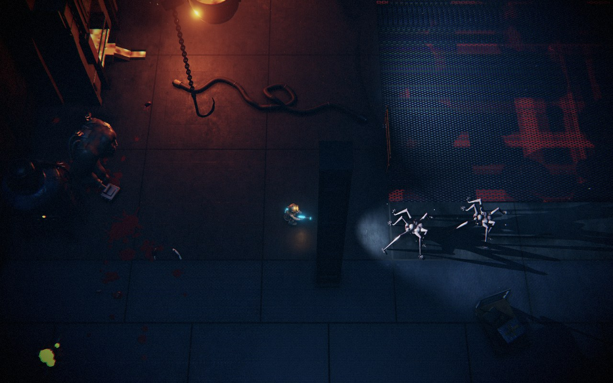

# NIGHT SHIFT

A short top-down survival-horror action game set in an abandoned factory. Built with three.js; plays in the browser on an Apple-silicon Mac (Chrome recommended). One run takes roughly 5–8 minutes.



## Play

**In your browser:** https://fusing-learning.github.io/night-shift-game/ (desktop Chrome, keyboard and mouse). Every push to `main` redeploys it.

**Locally:** double-click **`start.command`**. It installs dependencies on first run, builds the game and opens it in Chrome at `http://localhost:5273`. Go fullscreen (`⌃⌘F`) and wear headphones.

From a terminal instead:

```bash
npm install
npm run dev
```

## Controls

| Input | Action |
| --- | --- |
| `W A S D` | Move |
| Mouse | Aim (the character, torch and gun follow the cursor) |
| Left mouse | Fire the laser (uses the energy cell; overheats if spammed) |
| Right mouse / `Space` | Energy blade (close range; hits recharge the cell). Keep pressing for slash → backhand → lunging spin finisher |
| `Shift` | Dodge roll (brief invulnerability) |
| `F` | Torch on/off (dormant things notice you less with it off — but one kind only moves in the dark) |
| `E` | Use (keycard reader, breaker) |
| `Esc` / `M` | Pause / mute |

## What's in it

- Four factory areas (loading dock, assembly hall, warehouse, furnace hall) and a boss arena, with a checkpoint at each.
- Enemies: crawlers (fast swarmers), spitters (lob acid), stalkers (freeze in torchlight), a brute (slam and charge) and a three-phase boss.
- Laser sidearm with a recharging, overheating energy cell, plus an energy blade.

## How it was made

- `src/` — game code (rendering, lighting, level, AI, procedural animation, audio engine, HUD).
- `tools/blender/` — Blender Python scripts that generate every model in `public/models/` (run headlessly with `Blender -b --python <script>`).
- `tools/audio/` — Python/numpy scripts that synthesize every sound in `public/audio/` (`python3 tools/audio/build_all.py`).
- `public/textures/` — CC0 PBR textures from ambientCG (see `public/textures/CREDITS.md`).

## Debug URL flags

Append to the URL, e.g. `http://localhost:5273/?cp=4&god`:

- `cp=0..4` — start at a checkpoint (4 = just before the boss)
- `god` — invulnerable
- `bot` — autoplayer (used for automated playtests)
- `autostart`, `mute`, `nopause`, `noao`
- `blade=0..3` — blade style: 0 original, 1 crescent, 2 combo (default), 3 lightsweep; `B` cycles while the flag is set
- `bladelab` — blade test room in the furnace hall with respawning dummy targets (`B` / `0`–`3` style, `R` target layout)
